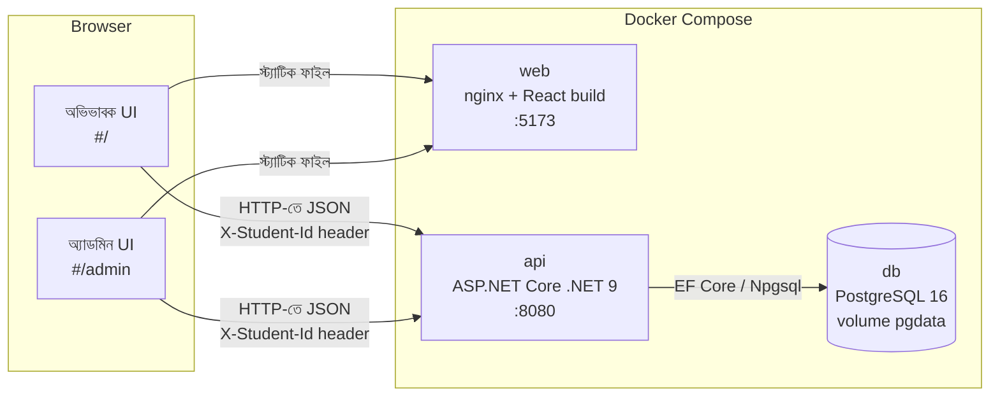
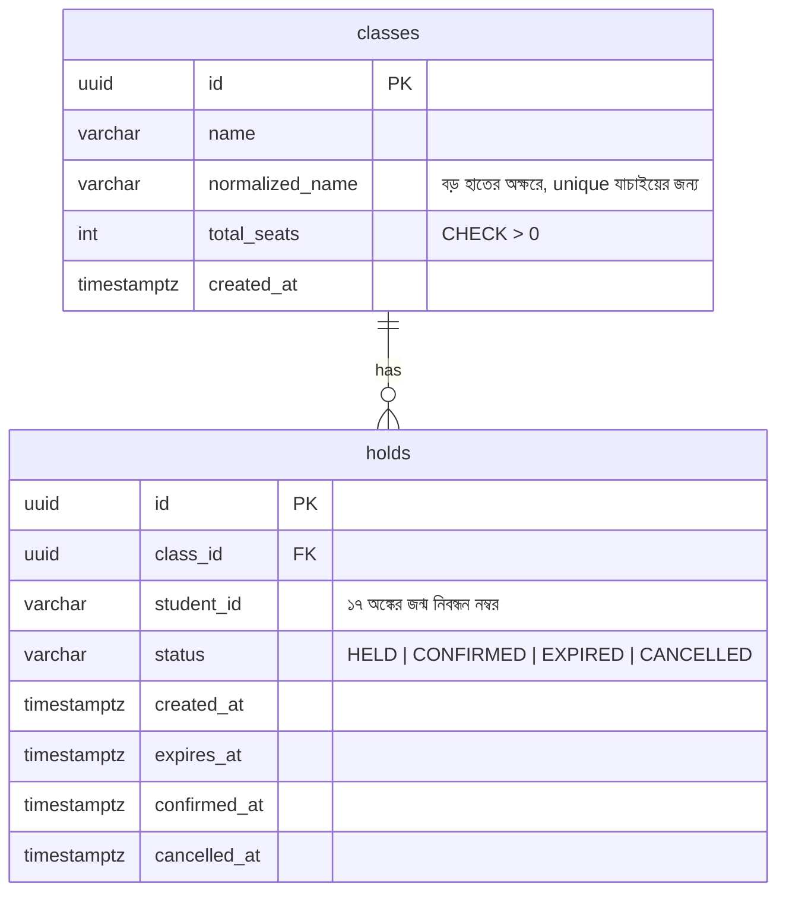
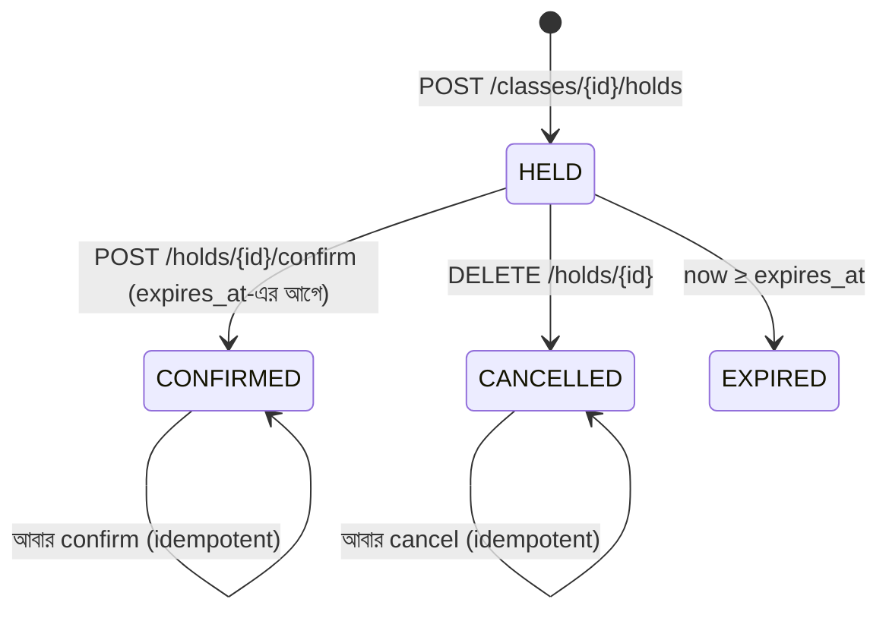

# আর্কিটেকচার (Architecture)

> English version: [ARCHITECTURE.md](ARCHITECTURE.md)

## সিস্টেমের সংক্ষিপ্ত চিত্র



ব্রাউজার `web` থেকে React অ্যাপ লোড করে এবং সরাসরি `api`-কে কল করে। API-এর URL কন্টেইনার চালু হওয়ার
সময় `config.js`-এ লেখা হয়, তাই image আবার build না করেই এটি বদলানো যায়।

## ব্যাকএন্ড: Clean Architecture

```
backend/
├── src/
│   ├── Admission.Domain          # Entity ও ব্যবসায়িক নিয়ম। কোনো নির্ভরতা নেই।
│   ├── Admission.Application     # Use case, DTO, repository interface। শুধু Domain-এর উপর নির্ভরশীল।
│   ├── Admission.Infrastructure  # EF Core, PostgreSQL, repository, migration, background job।
│   └── Admission.Api             # HTTP endpoint, error middleware, configuration, composition root।
└── tests/Admission.Tests         # Domain unit test + আসল PostgreSQL-এ API integration test।
```

নির্ভরতা শুধু ভেতরের দিকে: `Api → Infrastructure → Application → Domain`।

| স্তর | মূল টাইপ | দায়িত্ব |
|---|---|---|
| Domain | `SchoolClass`, `Hold`, `HoldStatus`, `StudentId`, `DomainException` | নিয়ম (সিট ১–১০০০০, ১৭ অঙ্কের শিক্ষার্থী আইডি) এবং hold-এর অবস্থা পরিবর্তনের নিয়ম (`Confirm`, `Cancel`, `StatusAt`)। |
| Application | `ClassService`, `HoldService`, `IClassRepository`, `IHoldRepository`, `IUnitOfWork` | Transaction-এর ভেতরে use case পরিচালনা করে; কখনো SQL স্পর্শ করে না। |
| Infrastructure | `AdmissionDbContext`, `ClassRepository`, `HoldRepository`, `UnitOfWork`, `HoldExpirySweeper` | Row lock, সিট গণনার query, constraint ম্যাপিং, স্টার্টআপে migration। |
| Api | `ClassEndpoints`, `HoldEndpoints`, `ErrorHandlingMiddleware` | HTTP ↔ use case এবং exception ↔ status code রূপান্তর। |

## ডাটাবেস ডিজাইন



| Constraint / index | উদ্দেশ্য |
|---|---|
| `ux_classes_normalized_name` (unique) | একই নামের দুটি class হবে না (বড়/ছোট হাতের অক্ষর নির্বিশেষে)। প্রতিটি shift আলাদা class। |
| `ck_classes_total_seats_positive` | `total_seats` অবশ্যই ধনাত্মক। |
| `ux_holds_one_active_per_student_class` — unique `(class_id, student_id)` **WHERE status IN ('HELD','CONFIRMED')** | ডাটাবেসের নিশ্চয়তা: প্রতি ক্লাসে একজন শিক্ষার্থীর একটিই সক্রিয় hold বা ভর্তি। |
| `ck_holds_status` | শুধু চারটি বৈধ অবস্থা সংরক্ষণ করা যায়। |
| `ix_holds_class_status_expires` | ক্লাসভিত্তিক দ্রুত সিট গণনা। |
| `ix_holds_status_expires` | দ্রুত মেয়াদোত্তীর্ণ hold পরিষ্কার। |
| `ix_holds_student_created` | দ্রুত "আমার hold" ইতিহাস। |

সিট সংখ্যা **কখনো আলাদা করে সংরক্ষণ করা হয় না**; সবসময় `holds` টেবিল থেকে গণনা করা হয়:

```
occupied  = CONFIRMED + (HELD যার expires_at > now)
available = total_seats − occupied
```

## Hold-এর জীবনচক্র



`expires_at` পার হয়ে যাওয়া `HELD` hold সাথে সাথেই `EXPIRED` হিসেবে দেখানো ও গণনা করা হয়, এমনকি background
sweeper (প্রতি `EXPIRY_SWEEP_SECONDS` সেকেন্ডে) সারিতে `EXPIRED` লেখার আগেই।

## Concurrency সুরক্ষা

| পরিস্থিতি | সুরক্ষা | ফলাফল |
|---|---|---|
| অনেক শিক্ষার্থী শেষ সিটের জন্য একসাথে চেষ্টা করে | Transaction + `SELECT … FROM classes WHERE id = $1 FOR UPDATE`। একটি ক্লাসের সব hold তৈরি আগমনের ক্রমে একটির পর একটি হয়; সিট গণনা ও insert lock-এর ভেতরে হয়। | ধারণক্ষমতার বেশি hold কখনো হয় না (পরীক্ষিত: ৫০ জন / ৫ সিট)। |
| একই শিক্ষার্থী একসাথে একাধিক hold পাঠায় | একই ক্লাস lock, এবং শেষ প্রতিরক্ষা হিসেবে আংশিক unique index (unique লঙ্ঘন → `409`)। | ঠিক একটি hold (পরীক্ষিত: ২০টি সমান্তরাল অনুরোধ)। |
| একই hold একসাথে কয়েকবার confirm | Transaction + `SELECT … FROM holds WHERE id = $1 FOR UPDATE`। প্রথম অনুরোধ confirm করে; বাকিরা `CONFIRMED` দেখে একই ফলাফল ফেরত দেয়। | একটিই ভর্তি, একই রকম response (পরীক্ষিত: ১৫টি সমান্তরাল)। |
| Confirm চলাকালীন hold-এর মেয়াদ শেষ | Hold সারির lock পাওয়ার *পরে* সেই মুহূর্তের সময় দিয়ে মেয়াদ যাচাই হয়। Sweeper-এর `UPDATE … WHERE status = 'HELD'` lock-এর জন্য অপেক্ষা করে, তারপর confirm হওয়া সারি বাদ দেয়। | হয় সময়মতো confirm, নয়তো `410 Gone` — কখনো দুটোই নয়। |
| Confirm ও cancel একসাথে | একই hold সারির lock। | ঠিক একটি সফল হয়; অন্যটি `409` পায়। |
| বারবার বাতিল | Hold সারির lock; বাতিল hold আবার বাতিল করলে কিছুই হয় না। | সব `204`, সিট একবারই খালি হয়। |
| অন্য শিক্ষার্থীর hold confirm | Hold লোড করার পরে backend-এ মালিকানা যাচাই। | `403 HOLD_NOT_OWNED`। |
| ব্যবহারকারীকে দেখানো সিট সংখ্যা | প্রতিটি অনুরোধে ডাটাবেস থেকে গণনা; UI প্রতি ৫ সেকেন্ডে আপডেট হয়। | সবসময় commit হওয়া অবস্থা দেখায়। |
| একই ডাটাবেসে দুটি backend process | উপরের প্রতিটি নিয়ম PostgreSQL-এ থাকে (row lock, unique index, গণনা করা সংখ্যা); process-এর memory-তে কিছু রাখা হয় না। | অতিরিক্ত বুকিং হয় না (পরীক্ষিত: দুটি host, ৭টি সিটের জন্য ৬০টি অনুরোধ; হাতে-কলমে `--profile multi` দিয়ে 8080 ও 8081 পোর্টে ৫টি সিটের জন্য ৬০টি অনুরোধ)। |

**Deadlock এড়ানো:** sweeper একটি statement-এ অনেক সারি update করে। তাই hold তৈরির সময় কখনো অন্য শিক্ষার্থীদের
hold একসাথে update করা হয় না; শুধু অনুরোধকারী শিক্ষার্থীর নিজের মেয়াদোত্তীর্ণ hold (সর্বোচ্চ একটি সারি) expire করা
হয়, যা আংশিক unique index মুক্ত করার জন্য প্রয়োজন। মেয়াদোত্তীর্ণ hold-এর সিট `expires_at > now` গণনায় এমনিতেই
বাদ পড়ে, তাই সঠিকতা sweeper-এর উপর নির্ভর করে না।

**সময়ের নির্ভুলতা:** সব সময় মাইক্রোসেকেন্ডে (PostgreSQL-এর নির্ভুলতা) কেটে নেওয়া হয়, ফলে লেখার ঠিক পরে
ফেরত দেওয়া response এবং পরে একই রেকর্ড পড়ার response হুবহু এক থাকে।

## ফ্রন্টএন্ড

```
frontend/src/
├── api/            # Typed fetch ক্লায়েন্ট (X-Student-Id যোগ করে), response টাইপ, ApiError
├── hooks/          # usePolling (দৃশ্যমান থাকলে প্রতি ৫ সেকেন্ডে), useCountdown
├── components/     # StudentIdBar (top of every page), Alert, Loading, Empty, StatusBadge, SeatBar
├── pages/admin/    # AdminPage, CreateClassForm, ClassHoldsPanel
├── pages/parent/   # ParentPage, StudentDashboard, ActiveHoldCard, AvailableClasses, HistoryTable
└── utils/          # ফরম্যাট সহায়ক, নিরাপদ localStorage
```

- রাউটিং hash-ভিত্তিক (`#/` অভিভাবক, `#/admin` অ্যাডমিন) — কোনো router লাইব্রেরি নেই।
- `localStorage`-এ শুধু শিক্ষার্থী আইডি রাখা হয়। সক্রিয় hold লোডের সময় এবং প্রতি ৫ সেকেন্ডে `GET /me/holds`
  থেকে পড়া হয়, তাই রিফ্রেশ বা ব্রাউজার রিস্টার্টের পরেও backend-ই আসল তথ্যের উৎস।
- Countdown server-এর `remainingSeconds` থেকে হিসাব হয়, তাই ব্রাউজারের ঘড়ি ভুল হলেও সমস্যা নেই। শূন্যে পৌঁছালে
  UI আবার backend থেকে তথ্য পড়ে।
