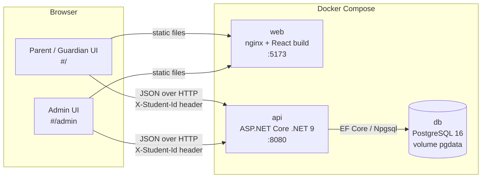
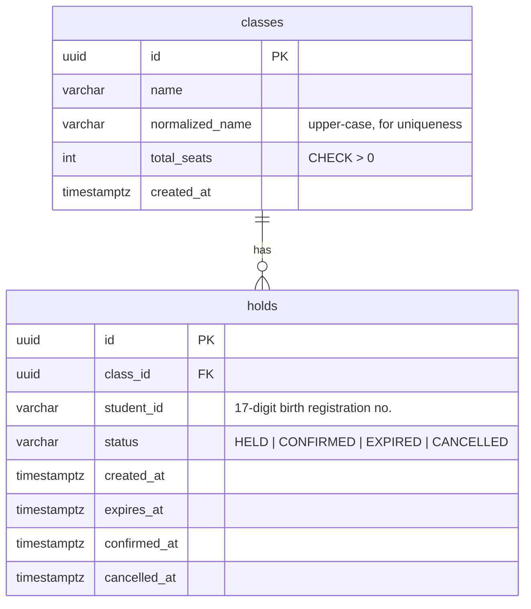
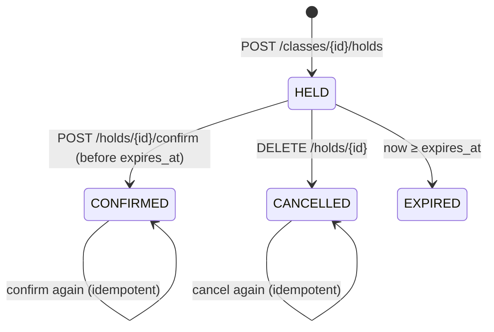

# Architecture

## System overview



The browser loads the React app from `web` and calls `api` directly. The API URL is injected at
container start into `config.js`, so it can change without rebuilding the image.

## Backend: Clean Architecture

```
backend/
├── src/
│   ├── Admission.Domain          # Entities and business rules. No dependencies.
│   ├── Admission.Application     # Use cases, DTOs, repository interfaces. Depends on Domain.
│   ├── Admission.Infrastructure  # EF Core, PostgreSQL, repositories, migrations, background job.
│   └── Admission.Api             # Controllers, error middleware, Swagger, versioning, composition root.
└── tests/Admission.Tests         # Domain unit tests + API integration tests on real PostgreSQL.
```

Dependencies point inward only: `Api → Infrastructure → Application → Domain`.

| Layer | Key types | Responsibility |
|---|---|---|
| Domain | `SchoolClass`, `Hold`, `HoldStatus`, `StudentId`, `DomainException` | Invariants (totalSeats 1–10000, 17-digit student id) and the hold state machine (`Confirm`, `Cancel`, `StatusAt`). |
| Application | `ClassService`, `HoldService`, `IClassRepository`, `IHoldRepository`, `IUnitOfWork` | Orchestrates a use case inside a transaction; never touches SQL. |
| Infrastructure | `AdmissionDbContext`, `ClassRepository`, `HoldRepository`, `UnitOfWork`, `HoldExpirySweeper` | Row locks, seat counting queries, constraint mapping, migrations at startup. |
| Api | `ClassesController`, `ClassHoldsController`, `HoldsController`, `MeController`, `ErrorHandlingMiddleware`, `SwaggerSetup`, `ApiVersioningSetup` | Maps HTTP ↔ use cases and exceptions ↔ status codes; Swagger UI at `/swagger`; API versioning by `X-Api-Version` header or `?api-version=` (default 1.0). |

### Controllers

| Controller | Routes |
|---|---|
| `ClassesController` | `POST /classes`, `GET /classes`, `GET /classes/{classId}` |
| `ClassHoldsController` | `POST /classes/{classId}/holds` (apply), `GET /classes/{classId}/holds` (admin) |
| `HoldsController` | `GET /holds/{holdId}`, `POST /holds/{holdId}/confirm`, `DELETE /holds/{holdId}` |
| `MeController` | `GET /me/holds` |

All inherit `ApiControllerBase` (`[ApiController]`, `[ApiVersion(1.0)]`). Controllers only translate HTTP to
use cases in the Application layer; business rules live in Domain and Application.

## Database design



| Constraint / index | Purpose |
|---|---|
| `ux_classes_normalized_name` (unique) | No duplicate class name (case-insensitive). Each shift is its own class. |
| `ck_classes_total_seats_positive` | `total_seats` must be positive. |
| `ux_holds_one_active_per_student_class` — unique `(class_id, student_id)` **WHERE status IN ('HELD','CONFIRMED')** | Database guarantee: one active hold or admission per student per class. |
| `ck_holds_status` | Only the four valid statuses can be stored. |
| `ix_holds_class_status_expires` | Fast seat counting per class. |
| `ix_holds_status_expires` | Fast expiry sweep. |
| `ix_holds_student_created` | Fast "my holds" history. |

Seat counts are **never stored**; they are always computed from `holds`:

```
occupied  = CONFIRMED + (HELD with expires_at > now)
available = total_seats − occupied
```

## Hold lifecycle



A `HELD` hold whose `expires_at` has passed is reported and counted as `EXPIRED` immediately, even
before the background sweeper (every `EXPIRY_SWEEP_SECONDS`) writes `EXPIRED` to the row.

## Concurrency protection

| Scenario | Protection | Result |
|---|---|---|
| Many students race for the last seat(s) | Transaction + `SELECT … FROM classes WHERE id = $1 FOR UPDATE`. All hold creation for a class is serialised in arrival order; the seat count and the insert happen under the lock. | Never more holds than totalSeats (tested: 50 students / 5 seats). |
| Same student sends parallel holds | Same class lock, plus the partial unique index as a last line of defence (unique violation → `409`). | Exactly one hold (tested: 20 parallel requests). |
| Same hold confirmed in parallel | Transaction + `SELECT … FROM holds WHERE id = $1 FOR UPDATE`. The first request confirms; the rest see `CONFIRMED` and return the same body. | One admission, identical responses (tested: 15 parallel). |
| Hold expires while being confirmed | Expiry is evaluated *after* the hold row lock is acquired, using the time at that moment. The sweeper's `UPDATE … WHERE status = 'HELD'` waits for the lock and then skips the confirmed row. | Either confirmed in time or `410 Gone` — never both. |
| Confirm races with cancel | Same hold row lock. | Exactly one wins; the other gets `409`. |
| Repeated cancellation | Hold row lock; cancelling a cancelled hold is a no-op. | All `204`, seat released once. |
| Confirming another student's hold | Ownership check on the backend after loading the hold. | `403 HOLD_NOT_OWNED`. |
| Seat availability shown to users | Computed from the database on every request; UI polls every 5 s. | Always reflects committed state. |
| Two backend processes on one database | Every rule above lives in PostgreSQL (row locks, unique index, computed counts); nothing is held in process memory. | No overbooking (tested: two hosts, 60 requests / 7 seats; manually with `--profile multi`: 60 requests / 5 seats across ports 8080 and 8081). |

**Deadlock avoidance:** the sweeper updates many rows in one statement. Hold creation therefore never
bulk-updates other students' holds; it only expires the requesting student's own overdue hold (at most
one row, needed to free the partial unique index). Seats of overdue holds are already excluded by the
`expires_at > now` count, so correctness does not depend on the sweeper.

**Timestamp precision:** all times are truncated to microseconds (PostgreSQL precision) before use,
so a response returned right after a write is identical to the same record read later.

## Frontend

```
frontend/src/
├── api/            # Typed fetch client (adds X-Student-Id), response types, ApiError
├── hooks/          # usePolling (5 s refresh while visible), useCountdown
├── components/     # StudentIdBar (top of every page), Alert, Loading, Empty, StatusBadge, SeatBar
├── pages/admin/    # AdminPage, CreateClassForm, ClassHoldsPanel
├── pages/parent/   # ParentPage, StudentDashboard, ActiveHoldCard, AvailableClasses, HistoryTable
└── utils/          # format helpers, safe localStorage
```

- Routing is hash based (`#/` parent, `#/admin` admin) — no router dependency.
- Only the student id is persisted in `localStorage`. Active holds are re-read from `GET /me/holds`
  on load and every 5 seconds, so the backend remains the source of truth after refreshes or restarts.
- The countdown is anchored to the server's `remainingSeconds` at fetch time, so browser clock skew
  does not matter. When it reaches zero the UI re-reads the backend.
